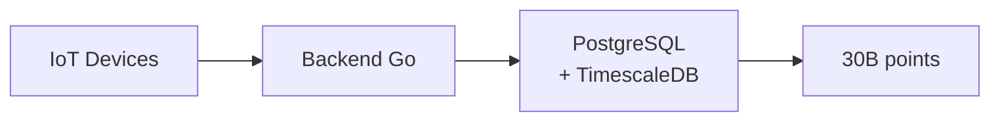

# Comment la Petite Souris gère ses milliards de dents avec TimescaleDB

Une histoire de séries temporelles à grande échelle

<div class="pt-12">
  <span @click="$slidev.nav.next" class="px-2 py-1 rounded cursor-pointer" hover="bg-white bg-opacity-10">
    Commencer <carbon:arrow-right class="inline"/>
  </span>
</div>

<div class="abs-br m-6 flex gap-2">
  <span class="text-sm opacity-75">Meetup - 13 novembre 2024</span>
</div>

---
layout: center
---

# Qui suis-je ?

<div class="grid grid-cols-2 gap-4 mt-8">
<div>

## David Torres Dias

- DevOps & Dev Backend Go
- Chez **Karnott** (Agriculture connectée)
- Passionné par les bases de données
- GitHub: @defts

</div>
<div class="flex items-center justify-center">



</div>
</div>

---
layout: two-cols
---

# Retour d'expérience Karnott

## Les chiffres

- **~30 milliards** de points de données
- **~5 To** de stockage (11 To sans compression)
- **Dizaines de millions** de nouvelles données/jour
- **Millions** de requêtes/jour

## Stack technique

- PostgreSQL 16 + **TimescaleDB** + PostGIS
- Google Cloud Platform (Cloud SQL)
- Kubernetes (GKE)

::right::

<div class="mt-20">

## Les cas d'usage

- Tracking GPS des engins agricoles
- Calcul des surfaces travaillées
- Répartition des travaux
- Analyse temporelle

## Le problème

❌ Requêtes lentes sur gros volumes
❌ Stockage qui explose
❌ Maintenance complexe

</div>

---

# Les gains mesurés

<div class="mt-8">

| Métrique | Avant | Après | Gain |
|----------|-------|-------|------|
| Requête "avg sur 7j par heure" | ~12s | ~0.8s | **15x** ⚡ |
| Stockage données > 1 an | 11 To | 1.2 To | **90%** 📦 |
| Temps de maintenance | 4h/mois | ~0h | **100%** 🎉 |

</div>

<div class="mt-12 text-center">
<v-click>

## → C'est pour ça qu'on parle de TimescaleDB aujourd'hui !

</v-click>
</div>

---
layout: center
class: text-center
---

# Mais pour vous montrer concrètement...

<v-click>

## On va parler de la **Petite Souris** ! 🐭🦷

</v-click>

---

# Le cas de la Petite Souris SA

## Les chiffres du business

<div class="grid grid-cols-2 gap-8 mt-8">
<div>

- **2 milliards** d'enfants dans le monde
- **~20 dents** de lait par enfant
- **Millions** de transactions par nuit
- Pic d'activité entre 6 et 12 ans

</div>
<div>

## Les questions métier

1. Prix moyen par mois/pays ?
2. Heures de pointe ?
3. Villes les plus généreuses ?
4. Inflation du prix de la dent ?
5. Optimisation des tournées ?

</div>
</div>

---

# Le schéma de données

```sql
CREATE TABLE tooth_loss (
    time            TIMESTAMPTZ NOT NULL,  -- Quand la dent est tombée
    child_id        INTEGER,               -- Quel enfant
    tooth_number    INTEGER,               -- Quelle dent (1-20)
    country         VARCHAR(2),            -- Pays
    city            VARCHAR(100),          -- Ville
    price           DECIMAL(10,2),         -- Prix payé
    payment_method  VARCHAR(20)            -- cash, coin, gift
);
```

<v-click>

## Le problème avec PostgreSQL classique

- Table qui grossit exponentiellement 📈
- Requêtes qui ralentissent 🐌
- Partition manuelle complexe 😰
- Pas de compression native efficace 💾

</v-click>

---
layout: center
---

# DÉMO 1 : Le problème PostgreSQL

<div class="text-sm opacity-75 mt-4">
(Live coding - montrer une requête lente)
</div>

---

# TimescaleDB : Les bases

<div class="grid grid-cols-2 gap-8 mt-8">
<div>

## Qu'est-ce que TimescaleDB ?

- **Extension** PostgreSQL (pas un fork !)
- 100% compatible PostgreSQL
- Spécialisé séries temporelles
- Open source

</div>
<div>

## Les concepts clés

**Hypertable** : table virtuelle qui partitionne automatiquement

**Chunks** : partitions sous le capot (par défaut 7 jours)

→ Transparent pour l'utilisateur (SQL standard)

</div>
</div>

---

# DÉMO 2 : Installation et première hypertable

```sql
-- 1. Activer l'extension
CREATE EXTENSION IF NOT EXISTS timescaledb;

-- 2. Créer la table (SQL classique)
CREATE TABLE tooth_loss (
    time TIMESTAMPTZ NOT NULL,
    child_id INTEGER,
    tooth_number INTEGER,
    country VARCHAR(2),
    city VARCHAR(100),
    price DECIMAL(10,2),
    payment_method VARCHAR(20)
);

-- 3. Transformer en hypertable (la magie opère !)
SELECT create_hypertable('tooth_loss', 'time');
```

<v-click>

## ✅ C'est tout ! TimescaleDB gère maintenant le partitionnement automatiquement

</v-click>

---

# DÉMO 2 (suite) : Génération de données

```sql
-- Générer ~100M de lignes sur 5 ans
INSERT INTO tooth_loss
SELECT
    time,
    (random() * 2000000000)::int as child_id,
    (random() * 20 + 1)::int as tooth_number,
    (ARRAY['FR', 'DE', 'ES', 'IT', 'US', 'UK', ...])[...] as country,
    'City_' || (random() * 10000)::int as city,
    (random() * 10 + 0.5)::decimal(10,2) as price,
    CASE WHEN random() < 0.7 THEN 'cash'
         WHEN random() < 0.9 THEN 'coin'
         ELSE 'gift' END as payment_method
FROM generate_series(
    NOW() - INTERVAL '5 years',
    NOW(),
    INTERVAL '1.5 seconds'
) AS time;
```

<div class="text-sm opacity-75 mt-4">
⏱️ Temps d'exécution : 2-3 minutes
</div>

---

# time_bucket : Le superpouvoir

<div class="grid grid-cols-2 gap-4 mt-8">
<div>

## Avant (PostgreSQL classique)

```sql
SELECT
    date_trunc('month', time) AS month,
    AVG(price) as avg_price,
    COUNT(*) as transactions
FROM tooth_loss
WHERE time > NOW() - INTERVAL '1 year'
GROUP BY month
ORDER BY month;
```

❌ Limité aux intervalles standards
❌ Pas optimisé pour les hypertables

</div>
<div>

## Après (TimescaleDB)

```sql
SELECT
    time_bucket('1 month', time) AS month,
    AVG(price) as avg_price,
    COUNT(*) as transactions
FROM tooth_loss
WHERE time > NOW() - INTERVAL '1 year'
GROUP BY month
ORDER BY month;
```

✅ Intervalles flexibles
✅ Optimisé pour TimescaleDB
✅ Beaucoup plus rapide !

</div>
</div>

---

# DÉMO 3 : Requêtes temporelles

## Exemples de requêtes métier

1. Prix moyen par mois
2. Pics d'activité par heure
3. Top villes généreuses
4. Évolution hebdomadaire avec window functions
5. Analyse par jour de la semaine
6. Intervalle custom (toutes les 6 heures)

<div class="text-sm opacity-75 mt-8">
(Live coding - montrer les performances)
</div>

---

# Les 3 piliers de l'optimisation

<div class="grid grid-cols-3 gap-4 mt-12">
<div class="text-center">

## 🗜️ Compression

Réduction de **90%** du stockage

Données anciennes rarement modifiées

Performances maintenues

</div>
<div class="text-center">

## 🗑️ Retention

Suppression automatique des vieilles données

Libération d'espace

Maintenance zéro

</div>
<div class="text-center">

## ⚡ Continuous Aggregates

Pré-calcul des agrégations

Mise à jour automatique

Requêtes instantanées

</div>
</div>

---

# DÉMO 4 : Compression

```sql
-- 1. Activer la compression
ALTER TABLE tooth_loss SET (
    timescaledb.compress,
    timescaledb.compress_segmentby = 'country',
    timescaledb.compress_orderby = 'time DESC'
);

-- 2. Compresser les chunks > 7 jours
SELECT compress_chunk(chunk)
FROM timescaledb_information.chunks
WHERE hypertable_name = 'tooth_loss'
  AND range_end < NOW() - INTERVAL '7 days';

-- 3. Policy automatique
SELECT add_compression_policy('tooth_loss', INTERVAL '7 days');
```

<div class="text-center mt-8">
<v-click>

## 📊 Résultat : 10 Go → 1 Go (90% de réduction) 🎉

</v-click>
</div>

---

# DÉMO 5 : Retention Policies

```sql
-- Supprimer automatiquement les données > 3 ans
SELECT add_retention_policy('tooth_loss', INTERVAL '3 years');
```

<div class="mt-8">

## Stratégie recommandée

<div class="grid grid-cols-3 gap-4 mt-4">
<div>

**0-7 jours**

NON compressées

Modifiables

</div>
<div>

**7j - 3 ans**

COMPRESSÉES

Lecture seule

</div>
<div>

**> 3 ans**

SUPPRIMÉES

Automatiquement

</div>
</div>
</div>

---

# DÉMO 6 : Continuous Aggregates

```sql
-- 1. Créer une vue matérialisée continue
CREATE MATERIALIZED VIEW daily_stats
WITH (timescaledb.continuous) AS
SELECT
    time_bucket('1 day', time) AS day,
    country,
    COUNT(*) as teeth_count,
    AVG(price) as avg_price,
    SUM(price) as total_revenue
FROM tooth_loss
GROUP BY day, country;

-- 2. Policy de rafraîchissement automatique
SELECT add_continuous_aggregate_policy('daily_stats',
    start_offset => INTERVAL '1 month',
    end_offset => INTERVAL '1 hour',
    schedule_interval => INTERVAL '1 hour'
);
```

---

# Performances : Avant/Après

<div class="mt-12">

| Requête | Sans Continuous Aggregate | Avec Continuous Aggregate | Gain |
|---------|--------------------------|---------------------------|------|
| Stats journalières (6 mois) | ~8 secondes | ~0.1 seconde | **80x** |
| Stats mensuelles (5 ans) | ~15 secondes | ~0.2 seconde | **75x** |
| Top villes (1 an) | ~5 secondes | ~0.08 seconde | **60x** |

</div>

<div class="text-center mt-12">
<v-click>

## 🚀 Et ça se rafraîchit automatiquement !

</v-click>
</div>

---
layout: two-cols
---

# Points clés à retenir

## ✅ Les avantages

- Extension PostgreSQL (pas de migration)
- Partitionnement automatique
- time_bucket = agrégations puissantes
- Compression native (~90%)
- Retention automatique
- Continuous aggregates
- Production-ready

::right::

<div class="mt-12">

## ⚠️ Pièges à éviter

- Bien choisir la colonne de temps (TIMESTAMPTZ !)
- Adapter la taille des chunks
- Tester la compression avant prod
- Ne pas oublier les index
- Planifier la stratégie de rétention

</div>

---

# Ressources

<div class="grid grid-cols-2 gap-8 mt-12">
<div>

## 📚 Documentation

- [docs.timescale.com](https://docs.timescale.com)
- [GitHub TimescaleDB](https://github.com/timescale/timescaledb)
- [Blog Timescale](https://www.timescale.com/blog)

</div>
<div>

## 🎯 Cette présentation

- Repo GitHub : [github.com/defts/prez-timescaledb](https://github.com/defts/prez-timescaledb)
- Tous les scripts SQL
- Docker Compose prêt à l'emploi
- Documentation complète

</div>
</div>

---
layout: center
class: text-center
---

# Merci ! 🎉

## Questions ?

<div class="mt-12 opacity-75">
David Torres Dias - david@torresdias.fr

@defts
</div>

<div class="mt-8 text-sm opacity-50">
Présentation créée avec Slidev • github.com/defts/prez-timescaledb
</div>
