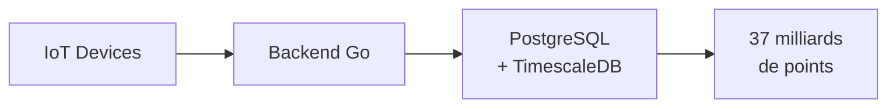

# Comment la Petite Souris gère ses milliards de dents avec TimescaleDB

Des séries temporelles à croquer

<div class="pt-12">
  <span @click="$slidev.nav.next" class="px-2 py-1 rounded cursor-pointer" hover="bg-white bg-opacity-10">
    Commencer <carbon:arrow-right class="inline"/>
  </span>
</div>

<div class="abs-br m-6 flex gap-2">
  <span class="text-sm opacity-75">Meetup PostgreSQL Lille - 13 novembre 2025</span>
</div>

---
layout: center
---

# Qui suis-je ?

<div class="grid grid-cols-2 gap-4 mt-8">
<div>

## David Torres Dias

- 👨‍💻 Développeur depuis bientôt **15 ans**
- 🐘 Utilisateur PostgreSQL depuis **15 ans** (depuis la version 8.4 !)
- 🐹 Amoureux de Go depuis **2015**
- 🚜 DevOps & Dev Backend Go chez **Karnott** depuis **7 ans**
- 📊 Mon histoire avec TimescaleDB a commencé chez Karnott
- 💾 Passionné par les bases de données et l'optimisation
- GitHub: @defts

</div>
<div class="flex items-center justify-center">



</div>
</div>

---

# C'est quoi TimescaleDB ?

<div class="mt-8">

## Une extension PostgreSQL

- 📦 **Extension PostgreSQL** pour les séries temporelles
- ✅ **100% compatible** PostgreSQL (juste `CREATE EXTENSION`)
- 🔓 **Open source** (Apache 2.0) + version cloud disponible
- 🚀 Utilisé par milliers d'entreprises (Cisco, IBM, Karnott, Warner Music...)

## Le concept clé : Hypertables

```sql
-- 1. Table normale PostgreSQL
CREATE TABLE metrics (time TIMESTAMPTZ, device_id INT, value FLOAT);

-- 2. La transformer en hypertable
SELECT create_hypertable('metrics', 'time');
```

<v-click>

➡️ **Partitionnement automatique** par période (chunks)

➡️ **API PostgreSQL standard** (SELECT, INSERT, INDEX...)

➡️ **Optimisations automatiques** pour les requêtes temporelles

</v-click>

</div>

---

# Les superpowers de TimescaleDB

<div class="grid grid-cols-3 gap-6 mt-8">

<div class="text-center">

### 🚀 PostgreSQL surchargé

S'appuie sur le même PostgreSQL que vous connaissez et aimez, avec un SQL complet, une fiabilité à toute épreuve et un écosystème massif.

</div>

<div class="text-center">

### 🔄 Relationnel & séries temporelles

Simplifiez votre stack, posez des questions plus complexes et construisez des applications plus puissantes.

</div>

<div class="text-center">

### ☁️ Opérations sans souci

Laissez-nous gérer TimescaleDB pour vous, entièrement managé sur AWS, Azure ou GCP dans plus de 75 régions.

</div>

<div class="text-center">

### 💰 Coûts réduits

Dépensez moins avec des taux de compression de **94%** grâce aux meilleurs algorithmes et autres améliorations de performance.

</div>

<div class="text-center">

### 📈 Échelle massive

Écrivez des millions de points de données par seconde. Stockez des centaines de téraoctets ou des pétaoctets.

</div>

<div class="text-center">

### ⚡ Performances accélérées

Obtenez des requêtes **10 à 100x plus rapides** que PostgreSQL, InfluxDB et MongoDB. Optimisations natives pour les séries temporelles.

</div>

</div>

---
layout: two-cols
---

# Retour d'expérience Karnott

## Le contexte

- 📍 Agriculture connectée (tracking GPS)
- 📦 **37 milliards** de points de données
- 🚜 Milliers d'engins agricoles
- 📈 **10 hypertables** (location, events, logs, sensors...)

## Stack technique actuelle

- PostgreSQL 17 + **TimescaleDB 2.18** + PostGIS
- **Google Cloud Platform**
- VM (16 vCPUs, 64 GB RAM)

::right::

<div class="mt-20">

## Les cas d'usage

- Tracking GPS en temps réel
- Calcul des surfaces travaillées
- Répartition des travaux
- Analyse de productivité
- Alertes et anomalies

## Le défi initial

❌ Stockage qui explose

</div>

---

# Les gains mesurés avec TimescaleDB

## Compression des données

| Hypertable | Avant | Après | Gain |
|------------|-------|-------|------|
| **device_event** | 4.6 TB | 119 GB | **97.5%** |
| location | 5.9 TB | 394 GB | **93.4%** |
| log | 1.8 TB | 87 GB | **95.2%** |
| **Moyenne (10 tables)** | - | - | **94.7%** |

## Impact global

- 💾 Stockage : **16 TB → 4 TB** (75% de réduction)
- 🗜️ **12 TB économisés** grâce à la compression
- ⚙️ Maintenance de compression : **Automatique** (policies)
- 🎯 **10 001 chunks compressés** sur 18 976

<div class="mt-8 text-center">

### → C'est pour ça qu'on parle de TimescaleDB aujourd'hui !

</div>

---
layout: center
class: text-center
---

# Mais pour vous montrer concrètement...

<v-click>

## On va parler de la **Petite Souris** ! 🐭🦷

</v-click>

---

# Le cas de la Petite Souris SA

## Les chiffres du business

- **2 milliards** d'enfants dans le monde
- **~20 dents** de lait par enfant
- **Millions** de transactions par nuit
- Pic d'activité entre 6 et 12 ans

## Les défis techniques

- Analyser des milliards de transactions
- Requêtes temporelles complexes
- Stockage qui explose
- Besoin de performances en production

---

# Le schéma de données

<div class="grid grid-cols-2 gap-4 mt-4">
<div>

## Tables de référence

```sql
-- 60 pays
CREATE TABLE countries (
    code TEXT PRIMARY KEY,
    name TEXT NOT NULL,
    continent TEXT
);

-- 20 dents de lait
CREATE TABLE teeth (
    tooth_number INTEGER PRIMARY KEY,
    tooth_name TEXT NOT NULL,
    typical_age INTEGER
);

-- 50 millions d'enfants
CREATE TABLE children (
    child_id BIGINT PRIMARY KEY,
    birth_date DATE,
    country_code TEXT REFERENCES countries(code)
);
```

</div>
<div>

## Hypertable (séries temporelles)

```sql
CREATE TABLE tooth_loss (
    time TIMESTAMPTZ NOT NULL,
    child_id BIGINT
        REFERENCES children(child_id),
    tooth_number INTEGER
        REFERENCES teeth(tooth_number),
    country_code TEXT
        REFERENCES countries(code),
    city TEXT,
    price DECIMAL(4,2) CHECK (price >= 0)
);

-- Transformer en hypertable
SELECT create_hypertable(
    'tooth_loss', 'time'
);
```

**→ PostgreSQL complet + séries temporelles !**

</div>
</div>

---
layout: center
class: text-center
---

# La solution : TimescaleDB

<v-click>

Transformons cette table en hypertable et explorons les fonctionnalités !

</v-click>

<v-click>

<div class="mt-12">

→ **time_bucket** pour les agrégations temporelles

→ **Compression** pour réduire le stockage

→ **Continuous Aggregates** pour les performances

→ **Retention** pour la maintenance automatique

</div>

</v-click>

---

# time_bucket : Le superpouvoir

<div class="grid grid-cols-2 gap-4 mt-8">
<div>

## Avant (PostgreSQL classique)

```sql
SELECT
    date_trunc('month', time) AS month,
    AVG(price) as avg_price,
    COUNT(*) as transactions
FROM tooth_loss
WHERE time > NOW() - INTERVAL '1 year'
GROUP BY month
ORDER BY month;
```

❌ Limité aux intervalles standards

❌ Pas optimisé pour les hypertables

</div>
<div>

## Après (TimescaleDB)

```sql
SELECT
    time_bucket('6 hours', time) AS bucket,
    AVG(price) as avg_price,
    COUNT(*) as transactions
FROM tooth_loss
WHERE time > NOW() - INTERVAL '1 week'
GROUP BY bucket
ORDER BY bucket;
```

✅ Intervalles flexibles (6h, 90min, 15 jours...)

✅ Optimisé pour TimescaleDB

✅ Beaucoup plus rapide !

</div>
</div>

---

# DÉMO : Requêtes temporelles

## Exemples de requêtes métier

<!-- TODO: À définir après avoir testé les requêtes du script 03-queries.sql
Idées:
- Prix moyen par période (mois, semaine...)
- Pics d'activité par heure
- Top villes les plus généreuses
- Évolution hebdomadaire avec window functions
- Analyse par jour de la semaine
-->

**À définir après tests des requêtes**

<div class="text-sm opacity-75 mt-8">
(Live coding - montrer les performances)
</div>

---

# Les 3 piliers de l'optimisation

<div class="grid grid-cols-3 gap-4 mt-12">
<div class="text-center">

## 🗜️ Compression

Réduction de **~95%** du stockage

Données anciennes rarement modifiées

Performances maintenues

</div>
<div class="text-center">

## ⚡ Continuous Aggregates

Pré-calcul des agrégations

Mise à jour automatique

Requêtes instantanées

</div>
<div class="text-center">

## 🗑️ Retention

Suppression automatique des vieilles données

Libération d'espace

Maintenance zéro

</div>
</div>

---

# DÉMO : Compression

```sql
-- 1. Voir les stats de compression
SELECT * FROM hypertable_compression_stats('tooth_loss');

-- 2. Stats par chunk
SELECT * FROM chunk_compression_stats('tooth_loss')
WHERE compression_status = 'Compressed'
ORDER BY before_compression_total_bytes DESC
LIMIT 10;
```

<div class="text-center mt-8">
<v-click>

## 📊 Résultat : ~95% de compression en moyenne 🎉

</v-click>
</div>

---

# DÉMO : Continuous Aggregates

```sql
-- 1. Créer une vue matérialisée continue
CREATE MATERIALIZED VIEW daily_stats
WITH (timescaledb.continuous) AS
SELECT
    time_bucket('1 day', time) AS day,
    country,
    COUNT(*) as teeth_count,
    AVG(price) as avg_price,
    SUM(price) as total_revenue
FROM tooth_loss
GROUP BY day, country;

-- 2. Policy de rafraîchissement automatique
SELECT add_continuous_aggregate_policy('daily_stats',
    start_offset => INTERVAL '1 month',
    end_offset => INTERVAL '1 hour',
    schedule_interval => INTERVAL '1 hour'
);
```

---

# DÉMO : Retention Policies

```sql
-- 1. Voir les données actuelles
SELECT
    COUNT(*) as total_rows,
    MIN(time) as oldest_data,
    MAX(time) as newest_data,
    age(MAX(time), MIN(time)) as data_span
FROM tooth_loss;

-- 2. Ajouter une policy de rétention (1 ligne !)
SELECT add_retention_policy('tooth_loss', INTERVAL '3 years');

-- 3. Voir les policies actives
SELECT * FROM timescaledb_information.jobs
WHERE proc_name = 'policy_retention';
```

<div class="text-center mt-8">
<v-click>

## 🗑️ Les données > 3 ans seront supprimées automatiquement

</v-click>
</div>

---
layout: two-cols
---

# Points clés à retenir

## ✅ Les avantages

- Extension PostgreSQL (pas de migration)
- Partitionnement automatique
- time_bucket = agrégations puissantes
- Compression native (~95%)
- Retention automatique
- Continuous aggregates
- Production-ready

::right::

<div class="mt-12">

## ⚠️ Pièges à éviter

- Bien choisir la colonne de temps (TIMESTAMPTZ !)
- Adapter la taille des chunks
- Tester la compression avant prod
- Ne pas oublier les index
- Planifier la stratégie de rétention

</div>

---

# Ressources

<div class="grid grid-cols-2 gap-8 mt-12">
<div>

## 📚 Documentation

- [docs.timescale.com](https://docs.timescale.com)
- [GitHub TimescaleDB](https://github.com/timescale/timescaledb)
- [Blog Timescale](https://www.timescale.com/blog)

</div>
<div>

## 🎯 Cette présentation

- Repo GitHub : [github.com/defts/timescaledb-petite-souris](https://github.com/defts/timescaledb-petite-souris)
- Tous les scripts SQL
- Docker Compose prêt à l'emploi
- Documentation complète

</div>
</div>

---
layout: center
class: text-center
---

# Merci ! 🎉

## Questions ?

<div class="mt-12 opacity-75">
David Torres Dias - david@torresdias.fr

@defts
</div>

<div class="mt-8 text-sm opacity-50">
Présentation créée avec Slidev • github.com/defts/prez-timescaledb
</div>
