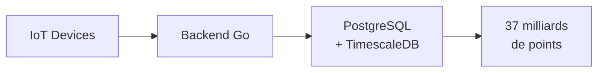

# Comment la Petite Souris gère ses milliards de dents avec TimescaleDB

Des séries temporelles à croquer

<div class="pt-12">
  <span @click="$slidev.nav.next" class="px-2 py-1 rounded cursor-pointer" hover="bg-white bg-opacity-10">
    Commencer <carbon:arrow-right class="inline"/>
  </span>
</div>

<div class="abs-br m-6 flex gap-2">
  <span class="text-sm opacity-75">Meetup PostgreSQL Lille - 13 novembre 2025</span>
</div>

---
layout: center
---

# Qui suis-je ?

<div class="grid grid-cols-2 gap-4 mt-8">
<div>

## David Torres Dias

- 👨‍💻 Développeur depuis bientôt **15 ans**
- 🐘 Utilisateur PostgreSQL depuis **10 ans+** (depuis la version 9.4 !)
- 🐹 Amoureux de Go depuis **2015**
- 🚜 DevOps & Dev Backend Go chez **Karnott** depuis **7 ans**
- 📊 Mon histoire avec TimescaleDB a commencé chez Karnott
- GitHub: @defts

</div>
<div class="flex items-center justify-center">



</div>
</div>

<!--
**Timing : 30 secondes**

Points à mentionner :
- Rapide : nom + rôle chez Karnott
- Insister sur : 15 ans PostgreSQL (légitimité)
- Karnott = agriculture connectée, IoT, GPS
- 37 milliards de points = crédibilité pour parler de scale
- Transition : "Mon histoire avec TimescaleDB a commencé chez Karnott"

💡 Rester concis, pas de détails techniques ici
-->

---

# C'est quoi TimescaleDB ?

## Une extension PostgreSQL

- 📦 **Extension PostgreSQL** pour les séries temporelles
- ✅ **100% compatible** (juste `CREATE EXTENSION`)
- 🔓 **Open source** (Apache 2.0 / TSL)
- 🚀 Utilisé par Cloudflare, le CERN, Karnott...

## Le concept clé : Hypertables

```sql
CREATE TABLE metrics (time TIMESTAMPTZ, device_id INT, value FLOAT);
SELECT create_hypertable('metrics', 'time');
```

<v-click>

→ 📦 Partitionnement automatique • 🔌 API PostgreSQL • ⚡ Optimisations

</v-click>

<!--
**Timing : 1 minute**

Points à mentionner :
- Extension PostgreSQL = pas de migration, juste CREATE EXTENSION
- 100% compatible = toutes les features PostgreSQL disponibles
- Open source = transparence, communauté
- Utilisateurs de référence = crédibilité
- Hypertables = concept clé (partitionnement automatique invisible)
- Montrer le code : 2 lignes suffisent !

💡 Insister sur la simplicité : "Juste 2 lignes de SQL"
-->

---
layout: center
class: text-center
---

# Mais pour vous montrer concrètement...

<v-click>

## On va parler de la **Petite Souris** ! 🐭🦷

</v-click>

<!--
**Timing : 10 secondes**

Points à mentionner :
- Transition ludique : "Pour vous montrer concrètement, on va quitter les tracteurs..."
- Laisser le suspense : attendre le clic pour révéler "La Petite Souris"
- Sourire, créer de la légèreté après les chiffres techniques

💡 Cette slide est un break, une respiration
-->

---

# Le cas de la Petite Souris SA

## Les chiffres du business

- **2 milliards** d'enfants dans le monde
- **~20 dents** de lait par enfant
- **Millions** de transactions par nuit
- Pic d'activité entre 6 et 12 ans

## Les défis techniques

- Analyser des milliards de transactions
- Requêtes temporelles complexes
- Stockage qui explose
- Besoin de performances en production

<!--
**Timing : 30 secondes**

Points à mentionner :
- Contexte ludique mais réaliste : 2 milliards d'enfants, 20 dents
- Millions de transactions par nuit = problème de scale similaire à Karnott
- Pic d'activité 6-12 ans = données temporelles avec patterns

Défis techniques (parallèle avec Karnott) :
- Analyser des milliards de transactions = même échelle
- Requêtes temporelles complexes = même problème
- Stockage qui explose = même défi
- Besoin de performances = même contrainte

💡 Faire le lien : "Mêmes défis que chez Karnott, mais avec des dents !"
-->

---

# Le schéma de données

<div class="grid grid-cols-2 gap-4 mt-4">
<div>

## Tables de référence

```sql
-- 60 pays
CREATE TABLE countries (
    code TEXT PRIMARY KEY,
    name TEXT NOT NULL,
    continent TEXT
);

-- 20 dents de lait
CREATE TABLE teeth (
    tooth_number INTEGER PRIMARY KEY,
    tooth_name TEXT NOT NULL,
    typical_age INTEGER
);

-- 50 millions d'enfants
CREATE TABLE children (
    child_id BIGINT PRIMARY KEY,
    birth_date DATE,
    country_code TEXT REFERENCES countries(code)
);
```

</div>
<div>

## Hypertable

```sql
CREATE TABLE tooth_loss (
    collected_at TIMESTAMPTZ NOT NULL,
    child_id BIGINT
        REFERENCES children(child_id),
    tooth_number INTEGER
        REFERENCES teeth(tooth_number),
    country_code TEXT
        REFERENCES countries(code),
    price DECIMAL(4,2) CHECK (price >= 0)
);

-- Transformer en hypertable
-- Partitionnement temporel + spatial
SELECT create_hypertable(
    'tooth_loss',
    by_range('collected_at', INTERVAL '7 day')
);
SELECT add_dimension(
    'tooth_loss', 
    by_hash('country_code', 4)
);
```

</div>
</div>

<!--
**Timing : 1 minute 30**

Points à mentionner :
- À gauche : tables de référence classiques (countries, teeth, children)
- À droite : LA table importante = tooth_loss (hypertable)
- Montrer le code : create_hypertable avec ses paramètres
- Insister : c'est du PostgreSQL standard + 1 fonction TimescaleDB

Structure tooth_loss :
- collected_at = colonne temporelle (TIMESTAMPTZ obligatoire)
- child_id, tooth_number = données métier
- **country_code = clé de partitionnement spatial (dimension)**
- price = la donnée à analyser

Partitionnement (IMPORTANT) :
- **Temporel** : chunks de 7 jours (automatique par défaut)
- **Spatial** : 4 partitions par country_code (explicite)
- Pourquoi country_code ? → Optimise les requêtes par pays ET la compression !
- On le verra plus tard : compress_segmentby = 'country_code'

💡 Message clé : "Double partitionnement = performance + compression optimale"
💡 Insister : le choix de country_code n'est pas anodin, c'est stratégique !
-->

---

# Architecture des chunks

<div class="mt-8">


</div>

<!--
**Timing : 30 secondes**

Points à mentionner :

- Visualisation du double partitionnement
- **Gauche** : Les dents (données) arrivent de différents pays (couleurs)
- **Centre** : L'hypertable reçoit tout
- **Droite** : Les chunks sont organisés en grille 2D
  - **Axe horizontal (TIME)** : older → newer (les vieux chunks s'éclaircissent)
  - **Axe vertical (SPACE)** : 4 partitions par country_code (hash)
  - Chaque couleur = un pays différent

Avantages du partitionnement spatial :
- Requêtes par pays = scan réduit (hash détermine la partition)
- Compression par partition = compress_segmentby efficace
- Parallélisation des requêtes = meilleure performance
- Note : 60 pays répartis sur 4 partitions (hash) = ~15 pays par partition

💡 Message clé : "Les chunks vieillissent horizontalement, se répartissent verticalement"
💡 Transition : "Maintenant, explorons les fonctionnalités..."
-->

---

# La solution : TimescaleDB

<div class="mt-12">

Transformons cette table en hypertable et explorons les fonctionnalités !

</div>

<!--
**Timing : 5 secondes**

Points à mentionner :
- Transition rapide : "Maintenant qu'on a notre hypertable..."
- Annoncer : "Je vais vous montrer 4 fonctionnalités clés en live"
- Garder le suspense, ne pas détailler ici

💡 Slide de transition, ne pas s'attarder
-->

---

# Au programme

<div class="grid grid-cols-4 gap-8 mt-8">
<div class="text-center">

## 📊
## Hyperfunctions

gapfill, stats_agg

Exclusives TimescaleDB

</div>
<div class="text-center">

## 🗜️
## Compression

**~95%** de réduction

Automatique

</div>
<div class="text-center">

## ⚡
## Caggs

Pré-calcul

10-100x plus rapide

</div>
<div class="text-center">

## 🗑️
## Retention

Suppression auto

Maintenance zéro

</div>
</div>

<!--
**Timing : 30 secondes**

Points à mentionner (balayage rapide des 4 colonnes) :
1. **Hyperfunctions** : Fonctions exclusives TimescaleDB (gapfill, stats_agg...)
2. **Compression** : ~95% de réduction (rappel du REX Karnott), automatique
3. **Caggs** : Continuous Aggregates = pré-calcul, 10-100x plus rapide
4. **Retention** : Suppression automatique des vieilles données, maintenance zéro

Message clé :
- "4 fonctionnalités qu'on va voir EN LIVE dans DataGrip"
- Créer l'attente : "On commence par les hyperfunctions"

💡 Énergique, rythme soutenu, créer l'excitation pour les démos
-->

---

# DÉMO : Hyperfunctions TimescaleDB

<div class="mt-12">

## Ce qu'on va voir

1. 🕳️ **time_bucket_gapfill()** - Remplir les trous dans les séries temporelles
2. 📊 **stats_agg()** - Un scan, toutes les statistiques
3. ⚡ **Function pipelines** (`->`) - Composition de fonctions lisible
4. 📈 **Percentiles approximatifs** - P50, P95, P99 ultra-rapides

</div>

<!--
**Timing : 5 minutes (démo live dans DataGrip)**

Script à exécuter : scripts/demo/01-hyperfunctions.sql

Déroulé de la démo (suivre le script) :

1. **PostgreSQL STANDARD vs time_bucket** :
   - Montrer la syntaxe horrible : extract('epoch')... / 1800 * 1800 😱
   - Puis time_bucket('30 minutes', collected_at) 😊 → Beaucoup plus lisible !
   - Problème révélé : ~36-40 lignes au lieu de 48 attendues (il manque 01:00, 03:00...)

2. **time_bucket_gapfill** :
   - Remplir les trous automatiquement → 48 lignes complètes (24h × 2/heure)
   - Bonus : marche avec window functions (cumulative_teeth)
   - Cas d'usage : graphiques sans trous, détection d'anomalies

3. **stats_agg + percentile_agg** :
   - PostgreSQL standard : AVG, STDDEV, VARIANCE = plusieurs scans
   - TimescaleDB : stats_agg + percentile_agg = UN SEUL scan 🚀
   - Function pipelines (->) : stats_agg -> average(), -> stddev()
   - Percentiles approx : P50, P90 ultra-rapides

Points clés à insister :
- Ces fonctions N'EXISTENT PAS dans PostgreSQL standard
- Un seul scan = beaucoup plus rapide
- Syntaxe lisible et composable avec ->

💡 Laisser tourner les requêtes, commenter les résultats
-->

---

# DÉMO : Compression

```sql
-- depuis TimescaleDB 2.18
-- 1. Activer la compression avec stratégie par pays
ALTER TABLE tooth_loss SET (
    timescaledb.enable_columnstore,
    timescaledb.segmentby = 'country_code'
);

-- 2. Policy : compresser automatiquement les données > 7 jours
SELECT add_columnstore_policy('tooth_loss', INTERVAL '7 days');

-- 3. Compresser manuellement les chunks existants
SELECT convert_to_columnstore(i, if_not_columnstore => true)
FROM show_chunks('tooth_loss', older_than => INTERVAL '7 days') i;

-- avant Timescaledb 2.18
-- ALTER TABLE tooth_loss SET (
--     timescaledb.compress,
--     timescaledb.compress_segmentby = 'country_code'
-- );
-- SELECT add_compression_policy('tooth_loss', INTERVAL '7 days');
-- SELECT compress_chunk(i, if_not_compressed => true)
-- FROM show_chunks('tooth_loss', older_than => INTERVAL '7 days') i;
```

<!--
**Timing : 3 minutes (démo live dans DataGrip)**

Script à exécuter : scripts/demo/02-compression.sql
⚠️  IMPORTANT : scripts/demo/prep-02-compression.sql doit être exécuté AVANT la prez

Déroulé de la démo :

1. **Montrer le code de la slide** (NE PAS l'exécuter en live) :
   - ALTER TABLE avec compress_segmentby = 'country_code' → rappel slide 8 !
   - add_compression_policy : automatique après 7 jours
   - Expliquer : déjà configuré avant la présentation

2. **Stats globales de compression** :
   - Exécuter hypertable_compression_stats('tooth_loss')
   - Montrer : taille avant/après, gain % (~95%), chunks compressés
   - Insister : 16TB → 6TB chez Karnott = 1 800 €/mois économisés !

3. **Détail par chunk** (optionnel si temps) :
   - Top 10 chunks compressés
   - Montrer les gains par période (range_start/end)

4. **Requêtes sur données compressées** :
   - Exécuter requête normale sur données compressées (Oct 2024)
   - Montrer : ça marche exactement pareil !
   - Décompression automatique et transparente
   - **À MENTIONNER À L'ORAL** : On peut aussi INSERT/UPDATE/DELETE sur chunks compressés
     → TimescaleDB décompresse uniquement les données nécessaires (pas le chunk entier)
     → Meilleure perf si on filtre sur segmentby/orderby (country_code dans notre cas)
     → C'est pour ça qu'on compresse les données anciennes (> 7j) = rarement modifiées

5. **Policy automatique** :
   - Montrer la policy active (jobs)
   - S'exécute toutes les 4 heures
   - Maintenance zéro !

💡 Insister : compress_segmentby = 'country_code' était un choix stratégique (slide 8)
💡 Message clé : compression automatique + transparente = économies immédiates
-->

---

# DÉMO : Continuous Aggregates

```sql
-- 1. Créer une vue matérialisée continue avec hyperfunctions + real-time
CREATE MATERIALIZED VIEW daily_revenue_stats
WITH (timescaledb.continuous, timescaledb.materialized_only = false) AS
SELECT
    time_bucket('1 day', collected_at) AS day,
    country_code,
    stats_agg(price) as price_stats,
    percentile_agg(price) as price_percentiles
FROM tooth_loss
GROUP BY day, country_code;

-- 2. Policy de rafraîchissement automatique
SELECT add_continuous_aggregate_policy('daily_revenue_stats',
    start_offset => INTERVAL '1 month',
    end_offset => INTERVAL '1 hour',
    schedule_interval => INTERVAL '1 hour'
);
```

<!--
**Timing : 3 minutes (démo live dans DataGrip)**

Script à exécuter : scripts/demo/03-caggs.sql
⚠️  IMPORTANT : scripts/demo/prep-03-caggs.sql doit être exécuté AVANT la prez

Déroulé de la démo :

1. **Montrer le code de la slide** (NE PAS l'exécuter en live) :
   - CREATE MATERIALIZED VIEW avec timescaledb.continuous
   - materialized_only = false → real-time ! (données < 1h incluses)
   - Utilise stats_agg + percentile_agg (hyperfunctions de la démo 1)
   - add_continuous_aggregate_policy : rafraîchissement automatique toutes les heures
   - Expliquer : déjà créée avant la présentation

2. **Requête sur la continuous aggregate** :
   - SELECT sur daily_revenue_stats (France, dernier mois)
   - Extraire stats avec function pipelines : average(), approx_percentile(0.50/0.95/0.99)
   - Insister : données pré-calculées + real-time (< 1h)
   - Ultra rapide !

3. **Comparaison : PostgreSQL exact vs TimescaleDB approximatif** (LE PUNCH !) :
   - EXPLAIN ANALYZE sur percentile_disc (PostgreSQL) → LENT, scan complet
   - EXPLAIN ANALYZE sur cagg (TimescaleDB) → ULTRA RAPIDE, pré-calculé
   - Montrer la différence de temps d'exécution (10-100x)
   - Résultats quasi identiques (<1% d'erreur), mais perf très différente !

4. **Infos sur la continuous aggregate** :
   - Stats : taille, compression, materialized_only
   - Refresh policy : schedule_interval, start_offset, end_offset
   - Maintenance automatique !

💡 Message clé : Pré-calcul + real-time + maintenance auto = dashboards ultra-rapides
💡 Cas d'usage : tableaux de bord, reporting, monitoring
-->

---

# DÉMO : Retention Policies

```sql
-- 1. Voir les données actuelles
SELECT
    COUNT(*) as total_rows,
    MIN(collected_at) as oldest_data,
    MAX(collected_at) as newest_data,
    age(MAX(collected_at), MIN(collected_at)) as data_span
FROM tooth_loss;

-- 2. Ajouter une policy de rétention (1 ligne !)
SELECT add_retention_policy('tooth_loss', INTERVAL '3 years');

-- 3. Voir les policies actives
SELECT * FROM timescaledb_information.jobs
WHERE proc_name = 'policy_retention';
```

<div class="text-center mt-8">
<v-click>

## 🗑️ Les données > 3 ans seront supprimées automatiquement

</v-click>
</div>

<!--
**Timing : 3 minutes (démo live dans DataGrip)**

Script à exécuter : scripts/demo/04-retention.sql

Déroulé de la démo :

1. **État actuel des données** :
   - Requête : MIN/MAX dates, COUNT, taille totale
   - Répartition par mois (12 derniers mois)
   - Montrer l'accumulation de données

2. **Le problème** :
   - Questions business : besoin de garder 5 ans de données ?
   - Coût stockage vs valeur des vieilles données
   - Conformité réglementaire : RGPS (Règlement Général des Petites Souris) 😄
     → Faire la blague, puis mentionner le vrai RGPD
   - Solution manuelle (DELETE) → Lent, bloquant, maintenance régulière

3. **Retention policy** (montrer le code de la slide) :
   - Afficher les policies existantes (jobs)
   - Montrer la commande : add_retention_policy('tooth_loss', INTERVAL '6 months')
   - ⚠️  NE PAS l'exécuter (sinon on perd les données de démo !)

4. **Comment ça marche** :
   - TimescaleDB découpe en chunks (partitions temporelles)
   - Policy s'exécute automatiquement (ex: toutes les semaines)
   - Supprime les chunks entiers (pas DELETE ligne par ligne)
   - DROP chunk = ultra-rapide vs DELETE

5. **Vue des chunks** :
   - Montrer les chunks actuels
   - Simuler : quels chunks seraient supprimés avec policy 6 mois ?
   - Montrer la taille de chaque chunk

6. **Avantages** :
   - Maintenance zéro, automatique
   - DROP chunk >> DELETE (perf)
   - Pas de VACUUM nécessaire
   - Coût stockage plafonné
   - Conformité RGPD

💡 Configuration typique : Logs 30-90j, Métriques 6-12 mois, Business 2-5 ans
💡 Combine bien avec compression + caggs (garder agrégats, supprimer détail)
-->

---
layout: two-cols
---

# Retour d'expérience Karnott

## Le contexte

- 📍 Agriculture connectée (tracking GPS)
- 📦 **37 milliards** de points de données
- 🚜 Milliers d'engins agricoles
- 📈 **10 hypertables** (location, events, logs, sensors...)

## Stack technique

- PostgreSQL 17 + **TimescaleDB 2.18** + PostGIS
- **Google Cloud Platform**
- VM (16 vCPUs, 64 GB RAM)
- Zonal SSD Persistent Disk

::right::

<div class="mt-12">

## Cas d'usage

- 📍 Tracking GPS temps réel
- 🚜 Surfaces travaillées
- 📊 Répartition des travaux
- ⚡ Analyse de productivité
- 🔔 Alertes et anomalies

## Défis initiaux

- ❌ Stockage qui explose
- ❌ Coûts GCP qui grimpent

</div>

<!--
**Timing : 2 minutes**

Points à mentionner :
- Contexte rapide : agriculture connectée = tracteurs GPS
- 37 milliards de points = échelle impressionnante
- 10 hypertables = pas juste un test, c'est en prod
- Stack : PostgreSQL 17 + TimescaleDB 2.18
- Note si question : TimescaleDB 2.23 (sorti le 29/10) supporte PG18, on upgradera bientôt
- Cas d'usage concrets = tracking temps réel, surfaces, alertes

Défis initiaux (insister) :
- Stockage qui explose = problème $$$
- Coûts cloud qui grimpent = pression business
- Maintenance manuelle = perte de temps

💡 Créer le suspense : "Comment on a résolu ça ? Avec TimescaleDB..."
-->

---

# Les gains mesurés avec TimescaleDB

## Compression des données

| Hypertable | Avant | Après | Gain |
|------------|-------|-------|------|
| **device_event** | 4.6 TB | 119 GB | **97.5%** |
| location | 5.9 TB | 394 GB | **93.4%** |

**Moyenne (10 tables) : 94.7% de compression**

## Impact global

- 💾 **16 TB → 6 TB** • 🗜️ **10 TB économisés**
- 💰 **-1 800 €/mois** (-21 600 €/an)
- ⚙️ Compression automatique (policies)

<div class="mt-4 text-center text-lg">

**→ ROI immédiat sur les coûts cloud !**

</div>

<!--
**Timing : 1 minute 30**

Points à mentionner (le punch) :
- Device_event : 4.6 TB → 119 GB = 97.5% !!!
- Location : 5.9 TB → 394 GB = 93.4%
- Moyenne sur 10 tables : 94.7% de compression
- Impact global : 16 TB → 6 TB (10 TB économisés)
- Le chiffre qui tue : -1 800 €/mois = -21 600 €/an
- Compression automatique = maintenance zéro

💡 Insister sur le ROI immédiat : "Ça paye la licence... sauf que c'est gratuit !"
💡 Créer l'enthousiasme : ces chiffres sont réels, en production
-->


---
layout: two-cols
---

# Points clés à retenir

## ✅ Les avantages

- Extension PostgreSQL (pas de migration)
- Partitionnement automatique
- time_bucket = agrégations puissantes
- Compression native (~95%)
- Retention automatique
- Continuous aggregates
- Production-ready

::right::

<div class="mt-12">

## ⚠️ Pièges à éviter

- Bien choisir la colonne de temps (TIMESTAMPTZ !)
- Adapter la taille des chunks
- Tester la compression avant prod
- Ne pas oublier les index
- Planifier la stratégie de rétention

</div>

<!--
**Timing : 1 minute**

Points à mentionner :

**Avantages** (gauche) - balayage rapide :
- Extension PostgreSQL = pas de migration, pas de nouveau langage
- Partitionnement auto = maintenance zéro
- Compression ~95% = économies immédiates (rappel Karnott : 1 800 €/mois)
- Production-ready = on l'utilise chez Karnott depuis des années

**Pièges** (droite) - insister :
- TIMESTAMPTZ obligatoire (pas TIMESTAMP sans timezone !)
- Taille des chunks : par défaut 7 jours, adapter selon volume
- Tester compression AVANT prod (certains types de données se compressent mal)
  → Données qui se compressent MAL : UUIDs, hashes, JSONB variable, données déjà compressées (images)
  → Données qui se compressent BIEN : valeurs répétitives (enum, country_code), séries numériques, timestamps
  → Notre cas (tooth_loss) : ~95% car country_code, tooth_number = faible cardinalité
- Index : TimescaleDB ne remplace pas les bonnes pratiques PostgreSQL
- Stratégie de rétention : décider dès le début (business + RGPD)

💡 Message clé : "TimescaleDB c'est du PostgreSQL++, pas un remplacement"
💡 Si question compression : UUIDs/hashes = 30-50% vs enum/répétitif = 90-95%
-->

---

# Ressources

<div class="grid grid-cols-2 gap-8 mt-12">
<div>

## 📚 Documentation

- [docs.timescale.com](https://docs.timescale.com)
- [GitHub TimescaleDB](https://github.com/timescale/timescaledb)
- [Blog Timescale](https://www.timescale.com/blog)

</div>
<div>

## 🎯 Cette présentation

- Repo GitHub : [github.com/defts/timescaledb-petite-souris](https://github.com/defts/timescaledb-petite-souris)
- Tous les scripts SQL
- Docker Compose prêt à l'emploi
- Documentation complète

</div>
</div>

<!--
**Timing : 30 secondes**

Points à mentionner :

**Documentation** (gauche) :
- docs.timescale.com = excellente doc, très complète
- GitHub TimescaleDB = voir le code source, issues, releases
- Blog Timescale = cas d'usage, best practices, nouveautés

**Cette présentation** (droite) :
- Tout le code est sur GitHub : github.com/defts/timescaledb-petite-souris
- Cloner le repo et lancer `make start` → Docker Compose prêt
- Tous les scripts SQL de démo sont là
- Vous pouvez reproduire chez vous en 5 minutes !

💡 Encourager : "N'hésitez pas à cloner le repo et tester, c'est fait pour ça !"
💡 Mentionner : "Je suis dispo après pour discuter, échanger sur vos cas d'usage"
-->

---
layout: center
class: text-center
---

# Merci ! 🎉

## Questions ?

<div class="mt-12 opacity-75">
David Torres Dias - david@torresdias.fr

@defts
</div>

<div class="mt-8 text-sm opacity-50">
Présentation créée avec Slidev • github.com/defts/timescaledb-petite-souris
</div>

<!--
**Timing : Variables (session Q&A)**

Points à mentionner :

- Remercier l'audience et les organisateurs du meetup PostgreSQL
- Ouvrir aux questions
- Si pas de questions : "N'hésitez pas à venir me voir après !"
- Rester dispo pour discussions individuelles après la session

Questions probables à anticiper :
1. "TimescaleDB vs ClickHouse/InfluxDB ?" → TimescaleDB = PostgreSQL complet, pas que time-series
2. "Quel impact sur les performances INSERT ?" → Négligeable, on insère des millions de rows/jour chez Karnott
3. "Compatibilité avec PostGIS ?" → Oui ! On l'utilise ensemble chez Karnott (GPS + géospatial)
4. "Licence ?" → Apache 2.0 (open source), pas de vendor lock-in
5. "Migration depuis PostgreSQL ?" → add extension + create_hypertable, c'est tout !
6. "Coût cloud ?" → Moins cher qu'un PostgreSQL standard (compression = -60% stockage)

💡 Rester humble, partager l'expérience Karnott, encourager à tester
-->
